<div align="center">



<br>


</div>

---

> 💡 **Clique nos comandos abaixo para expandir cada seção.**

<details open>
<summary><code>$ cat sobre.py</code></summary>

```python
class Developer:
    nome = "Augusto Mota"
    status = "Em formação, aprendendo todos os dias"
    formacao = "Cursando Desenvolvimento de Software Multiplataforma @ Fatec"
    estudando = ["Python", "SQL", "Java", "JavaScript", "PHP", "React", "TypeScript", "IA", "n8n"]

    def sobre(self):
        return [
            "Gosto de aprender na prática e resolver problemas",
            "Transformo ideias em soluções através da programação",
            "Explorando Inteligência Artificial e automação",
        ]

    def foco(self):
        return "Resolver problemas com tecnologia"
```

</details>

<details>
<summary><code>$ cat stack.json</code></summary>

```json
{
  "linguagens": ["Python", "SQL", "JavaScript", "Java", "PHP", "TypeScript"],
  "web": ["React", "HTML", "CSS", "Bootstrap"],
  "banco_de_dados": ["MySQL"],
  "ferramentas": ["Git", "GitHub", "VS Code", "Visual Studio"],
  "status": "em formação",
  "estudando": ["Python", "SQL", "Java", "JavaScript", "PHP", "React", "TypeScript", "IA", "n8n"]
}
```

<div align="center">

</div>

</details>

<details>
<summary><code>$ ls ./areas-de-interesse</code></summary>

```text
💻 desenvolvimento-de-software/
📊 dados/
🏗️ arquitetura-de-software/
🤖 inteligencia-artificial/
```

</details>

<details open>
<summary><code>$ git log --stats</code></summary>

<div align="center">



</div>

</details>

<details>
<summary><code>$ cat fora-do-codigo.txt</code></summary>

```text
📈 Economia
📖 Leitura
🚀 Inovação
⚽ Futebol
```

</details>

---

<div align="center">

### `$ ssh contato@venusroot`

<a href="https://github.com/Venusroot"></a>
<a href="https://www.linkedin.com/in/augusto-mota-dev/"></a>

<br>

<i>“Transformando conhecimento em soluções através da tecnologia.”</i>

</div>
